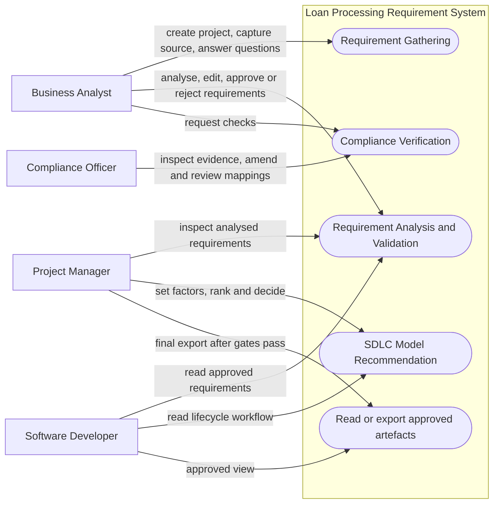
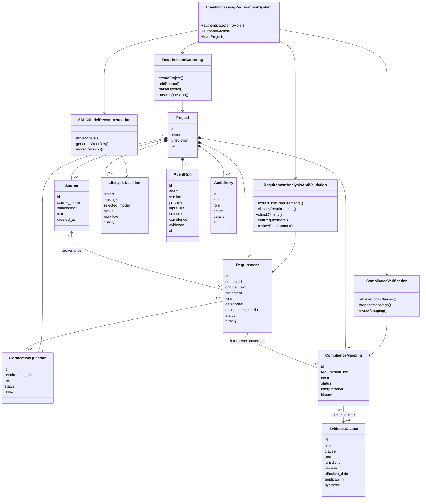
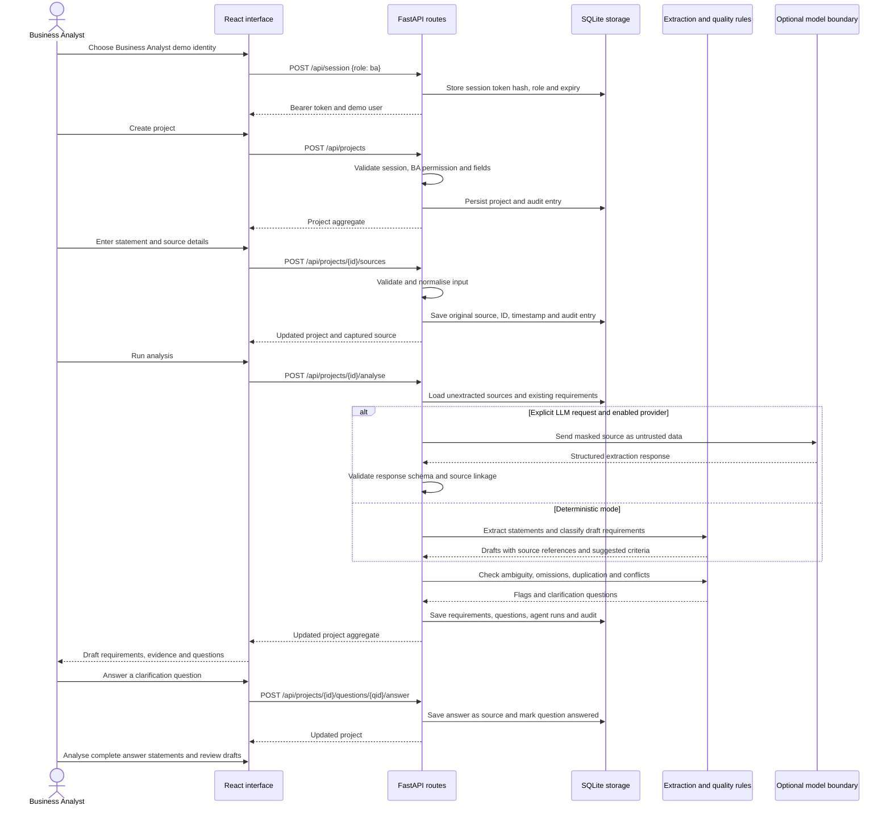

# Loan Processing Requirement System UML

These diagrams describe the prototype's four user-facing capabilities. The class view is a logical design: service boxes group Python functions and FastAPI routes; they are not claims that every box is a Python class. There is no operational loan application, credit decision or payment entity.

## Use cases

Mermaid flowchart notation expresses the actor/use-case relationships. Permission enforcement occurs in the API, not just in the interface.

## Logical component and entity diagram

The top-level system associates with four capability services, as requested by the coursework. The services collaborate; they do not inherit from the system. Projects own requirements and their provenance rather than customer lending records.

## Business Analyst and Requirement Gathering sequence

The implementation separates source capture from explicit analysis. Upload parsing or adding text alone does not silently call an external model. Answering a clarification question adds a linked source. Short answers remain interview context; complete statements can be analysed explicitly by the analyst.

Review and export are subsequent workflows. Requirement edits invalidate their previous approval; compliance decisions require the Compliance Officer role; lifecycle decisions require the Project Manager role. Final exports are checked server-side.

## Implementation boundaries

`app.py` assembles the application. `routes.py` exposes the calls shown above; `schemas.py` validates their bodies and `auth.py` enforces permissions. `services.py` loads a project snapshot, checks the client revision, applies the operation outside the writer lock and commits only if the stored revision is unchanged. `ingestion.py` parses documents in FastAPI worker threads. The frontend uses separate screen components and a shared `useWorkspace` hook, which handles expiry, server logout and stale revisions.
